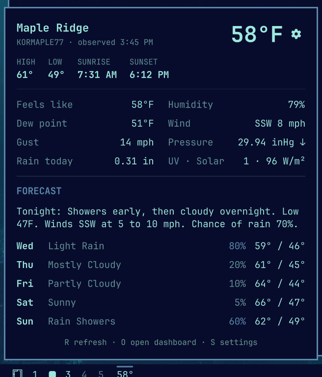

# Wunderground Station for Omarchy

An [Omarchy](https://omarchy.org/) bar widget that shows the current temperature from a
[Weather Underground](https://www.wunderground.com/) personal weather station (PWS), with a
popout for current conditions and the 5-day forecast.



- **Bar:** the station's temperature (or feels-like), in bold. If the station goes offline
  (a flat battery, lost Wi-Fi), the reading dims and keeps showing the last report until the
  station is back; the tooltip and panel show when it last reported.
- **Hover:** location, feels-like, humidity, dew point, wind and when the reading was taken.
- **Left click:** the detail panel. It shows today's high and low, sunrise and sunset, current
  conditions (wind and gusts, pressure and its trend, rain, UV, solar radiation) and the 5-day
  forecast. Keys: `R` refreshes, `O` opens the station's dashboard, `S` opens settings, `Esc` closes.
- **Right click:** opens the station's dashboard on wunderground.com.
- **Middle click:** refreshes the reading.

## Requirements

- Omarchy with the Quickshell bar (Omarchy 4, "Quattro").
- `curl` and `jq`, both included with Omarchy.
- A Weather Underground API key. Weather Underground gives free keys only to people who send
  it data from their own station, so you need to own a station that reports to Weather
  Underground. Once you have a key, the widget can show any public station, not just your own.

## Install

```bash
omarchy plugin add https://github.com/jeremiahjohnston/omarchy-wunderground --enable
```

`--enable` asks where to put the widget on the bar. You can move it later, for example to just
after the workspace numbers:

```bash
omarchy bar move io.github.jeremiahjohnston.wunderground --after omarchy.workspaces
```

## Set up your station and API key

Until both are set, the bar shows **WU setup**. Click it to open the setup form.

1. **Station ID.** Enter the ID of the station to show. It's the last part of the station's
   dashboard address: `wunderground.com/dashboard/pws/KCASANFR123` is station `KCASANFR123`.
   If it isn't your own station, the **Wundermap** button opens a map of stations to pick from.
2. **API key.** Sign in at wunderground.com and open **Member Settings → API Keys** (the
   **Get a key** button goes there), then generate a key and paste it in.
3. Press **Enter** or **Save**. The line under the buttons confirms that the station was found,
   or says what's wrong.

The key is saved to `~/.config/omarchy/wunderground.key`, which only you can read. It is never
put in `shell.json` or on a command line. You can also set the key or station from a terminal:

```bash
read -rsp 'API key: ' k && (umask 077; printf '%s\n' "$k" > ~/.config/omarchy/wunderground.key)
omarchy bar set io.github.jeremiahjohnston.wunderground stationId KCASANFR123
```

If `WU_API_KEY` is set in the shell's environment, it overrides the key file.

## Settings

Click the gear in the panel, or press `S`, to change these. They're stored in this widget's
entry in `~/.config/omarchy/shell.json`, so you can also set them with
`omarchy bar set io.github.jeremiahjohnston.wunderground <key> <value>` (add `--json` for
numbers and true/false).

| Setting | Default | Options |
| --- | --- | --- |
| `stationId` | none | A Weather Underground station ID |
| `units` | `auto` | `auto` (follows your locale), `e` (°F, mph), `m` (°C, km/h), `h` (°C, mph) |
| `barValue` | `temp` | `temp` or `feels` (feels-like) |
| `decimals` | `0` | `0` or `1` |
| `showUnit` | `false` | `true` shows `64°F` in the bar instead of `64°` |
| `showForecast` | `true` | `false` hides today's summary and the forecast |
| `bold` | `true` | Bold reading in the bar; `false` for regular weight |
| `accent` | `false` | `true` draws the reading in your theme's accent color instead of the bar's text color |
| `refreshSeconds` | `300` | How often to update, `60` to `3600` |

On a vertical bar the degree sign is left off so three-digit readings fit.

## Troubleshooting

- **"API key was rejected":** the key is wrong or was revoked. Generate a new one and paste it
  into the setup form.
- **"Station … not found or not reporting today":** check the station ID; IDs are case
  sensitive, but the widget upper-cases what you type.
- **The reading is dimmed and the panel says "offline since …":** the station has stopped
  reporting. The widget keeps showing its last report and picks the station up again
  automatically.
- **No hourly forecast:** Weather Underground keys for station owners don't include the
  hourly forecast, so the panel shows the 5-day daily forecast.
- **A change to the plugin's files doesn't show up:** run `omarchy restart shell`.

## Remove

```bash
omarchy plugin remove io.github.jeremiahjohnston.wunderground
rm -f ~/.config/omarchy/wunderground.key
```

## Development

The scripts in `scripts/` do the fetching, each printing one line of JSON:
`wu-current` for the current reading, `wu-details` for today's summary and the forecast, and
`wu-save-key` to store the key. Run the tests with:

```bash
for t in tests/wu-*.sh; do "$t"; done
```

## License

[MIT](LICENSE)
